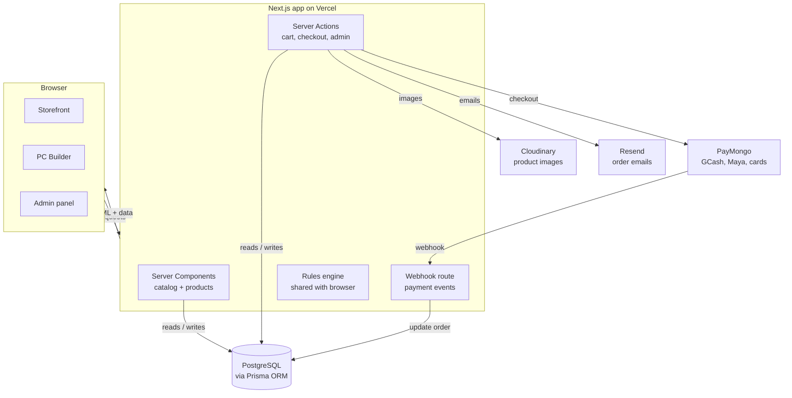
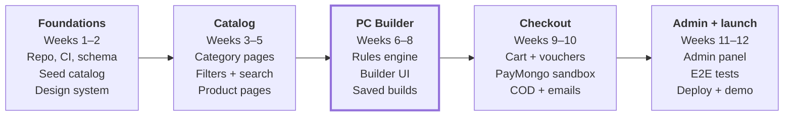

# PC Silicon — Product Requirements Document

Oct 19, 2026 · Romulo Ramos

**Version 1.0 — baseline for development.** Updated 23 October 2026. Changes after this point go through the change rules in *Development approach*.

## Overview

We are building a Philippine online store for PC parts whose core differentiator is a guided PC Builder that blocks incompatible parts before checkout. **Store name: PC Silicon**.

This is a portfolio / capstone project. It should look and behave like a real store, with real payment flows running in gateway sandbox (test) mode, but it will not take live money or ship real orders.

### Goals

1. Let a shopper find a part by category, brand and specs in under 3 clicks from the home page.
2. Let a first-time builder assemble a compatible PC in one session and add the whole build to cart in one click.
3. Support how Filipinos actually pay: GCash, Maya, cards, cash on delivery and installments.
4. Give the shop owner an admin panel to manage products, stock and orders without touching code.
5. Demonstrate production-grade engineering: typed data model, tests, auth, SEO and good performance.

### Non-goals (v1)

- Multi-vendor marketplace (one shop only).
- Live payments, real courier booking or BIR-compliant e-invoicing.
- Native mobile apps, and mobile-optimized layouts (planned for Phase 2; the MVP is desktop-first).
- Used / trade-in parts and repair service booking.

## Target users

Three shopper types and one admin type drive every requirement below.

| Persona | Who they are | What they need | Key features |
| --- | --- | --- | --- |
| First-time builder | Student or young professional, budget around PHP 25k–60k, unsure what fits | Confidence that parts work together; plain-language guidance | PC Builder, compatibility warnings, prebuilt templates, installments |
| Enthusiast / upgrader | Knows specs, buying one or two parts (GPU, SSD, RAM) | Fast spec filtering, price and stock visibility, comparisons | Faceted filters, compare, stock status, price-drop alerts (later) |
| Gift / office buyer | Buying a peripheral or a ready build for someone else | Simple checkout, trusted payment, clear warranty | Guest checkout, COD, warranty info on product page |
| Shop admin | Owner or staff of the PC shop | Update prices and stock fast, process orders, see what sells | Admin panel, bulk price/stock edit, order workflow, sales dashboard |

## Market research

PH PC shops compete on price, authenticity and after-sales trust; the online-first ones add a PC configurator with compatibility logic. That combination is our feature baseline.

| What we saw | Where | What it means for us |
| --- | --- | --- |
| Online-first PH retailer markets a custom PC builder with built-in compatibility logic, insured nationwide couriers, a physical showroom, and "brand new, sealed" guarantees | [Netcodex FAQ](https://netcodex.ph/faq/), [Netcodex news](https://netcodex.ph/news/) | Builder + trust signals (authenticity, warranty, SEC/BIR registration badges) belong on every page |
| Mall-chain retailer runs many branches; stock differs per branch and buyers value credit-card installments and warranty handling | [PC Express branches](https://pcx.com.ph/blogs/pc-express-branches/pc-express-sm-city-fairview), [r/PHbuildapc guide](https://lr.sudovanilla.org/r/PHBuildaPC) | Show stock status clearly; offer installments; make warranty policy visible |
| PH builders compare prices across stores and complain about slow replies on order and warranty issues | [r/PHbuildapc guide](https://lr.sudovanilla.org/r/PHBuildaPC) | Order tracking page and a clear RMA / warranty request flow reduce support load |
| Compatibility checkers validate CPU–motherboard socket, RAM support, PSU wattage and case clearance in real time | [PCPartsPicker docs](https://www.mintlify.com/modernharp/PCPartsPicker/features/compatibility-checking) | Defines our minimum rule set (see PC Builder) |
| Shopify PC-builder apps sell a step-by-step flow with real-time validation and one-click "add whole build to cart" | [PC Builder by MW](https://apps.shopify.com/pc-builder-v2) | Step-by-step flow and bundle add-to-cart are table stakes |
| PH is not card-first; gateways bundle GCash, Maya, QR Ph, cards and BNPL (BillEase, SPayLater) in one API | [HitPay comparison](https://hitpayapp.com/ph/blog/best-payment-gateway-in-the-philippines), [PhotonPay review](https://www.photonpay.com/hk/blog/article/payment-gateways-philippines?lang=en) | One gateway integration covers all our online methods |

**Gap to exploit:** most local shop sites are catalogs; few explain *why* parts conflict. Plain-language compatibility messages ("This CPU needs an AM5 board; you picked LGA1700") are our UX edge.

## Scope by phase

The MVP is a complete buy flow plus the PC Builder; everything else is layered on after.

| Area | MVP (Phase 1) | Phase 2 | Phase 3 / stretch |
| --- | --- | --- | --- |
| Catalog | Categories, product pages, specs, images, stock status | Product compare (up to 4), recently viewed | Price history chart |
| Search | Keyword search + faceted filters per category | Typo-tolerant search, autocomplete | AI "build me a PC for PHP 40k" assistant |
| PC Builder | Step-by-step builder, compatibility engine, wattage estimate, save & share build, add build to cart | Prebuilt templates (budget / 1080p / 1440p / workstation) | Community gallery of builds, FPS estimates |
| Cart & checkout | Cart, guest + account checkout, delivery (fee by region) or free store pickup, vouchers | Abandoned-cart email | Loyalty points |
| Payments | GCash, Maya, cards, installments / BNPL (all sandbox), COD | Partial COD (deposit online, rest on delivery) for high-value orders | — |
| Accounts | Sign up / login, addresses, order history, saved builds | Wishlist, back-in-stock and price-drop alerts | — |
| Post-purchase | Order status page, email notifications | Warranty / RMA request form, product reviews | Live chat |
| Admin | Products, inventory, orders, vouchers, basic sales dashboard | Bulk CSV import/export, roles (owner vs staff) | Analytics: top builds, conversion funnel |

**Screen priority:** the MVP is designed, built and tested for desktop first. Mobile-optimized layouts for every page, including the PC Builder, are a Phase 2 item, delivered before any other Phase 2 work.

## Functional requirements (storefront)

IDs (FR-x) are referenced by tickets and tests. All prices are in PHP, VAT-inclusive.

### Home and navigation

- **FR-1** Mega-menu of categories: CPU, Motherboard, Memory, Graphics Card, Storage, Power Supply, Case, CPU Cooler, Case Fans, Monitor, Peripherals (keyboard, mouse, headset), Networking, Prebuilt PCs.
- **FR-2** Home page: hero promo banner, "Build your PC" call-to-action, featured deals, best sellers, shop by brand, trust strip (authentic, warranty, secure payment, nationwide delivery).
- **FR-3** Persistent header search, cart count and account menu; mobile bottom-sheet menu.

### Catalog, search and filters

- **FR-4** Category listing with grid/list toggle, pagination or infinite scroll, sort by price, newest, best selling.
- **FR-5** Faceted filters driven by each category's spec schema, e.g. CPU: brand, socket, cores, TDP; GPU: chipset, VRAM, length; RAM: type (DDR4/DDR5), capacity, speed. Price range slider and "in stock only" on every category.
- **FR-6** Keyword search across name, brand, model number and key specs; results page reuses filters.
- **FR-7** Filter state lives in the URL so links are shareable and SEO-crawlable.

### Product page

- **FR-8** Image gallery with zoom, price (with sale price and % off), stock status (In stock / Low stock / Out of stock / Pre-order), quantity, Add to cart, Add to build.
- **FR-9** Full spec table from structured data, plus overview text, warranty period, what's in the box.
- **FR-10** "Compatible with" hints when the shopper has an active build (e.g. "Fits your current build" badge).
- **FR-11** Related products and "frequently bought together".

### Cart and checkout

- **FR-12** Cart supports single items and whole builds (a build shows as one grouped line that can be expanded).
- **FR-13** Stock is re-checked at checkout; out-of-stock lines are flagged before payment.
- **FR-14** Checkout in 3 steps: shipping method (delivery or store pickup) and address → shipping → payment. Guest checkout allowed; account creation offered after.
- **FR-15** PH address form: region → province → city/municipality → barangay dropdowns, plus street and ZIP.
- **FR-16** Shipping fee by zone (Metro Manila, Luzon, Visayas, Mindanao) and weight; free shipping threshold configurable.
- **FR-17** Voucher codes: fixed or % off, min spend, expiry, usage limit.

### Accounts and orders

- **FR-18** Email + password and Google sign-in; email verification; password reset.
- **FR-19** Address book, order history, saved builds.
- **FR-20** Order status timeline: Pending payment → Paid / COD confirmed → Processing → Shipped (with tracking number) or Ready for pickup → Delivered / Picked up; plus Cancelled and Refunded.
- **FR-21** Transactional emails: order confirmation, payment received, shipped, delivered.

## PC Builder

The builder lets a shopper pick one part per slot, checks every pair of parts as they go, and never lets an incompatible build reach checkout without a clear warning.

### Flow

1. Start empty or from a template (Phase 2).
2. Pick parts slot by slot: CPU → Motherboard → Memory → Storage → GPU → Case → PSU → CPU Cooler (fans, OS, peripherals optional). Slots can be filled in any order.
3. Each slot opens a filtered product list showing **only compatible, in-stock parts by default**, with a toggle to "show all" (incompatible items greyed out with the reason).
4. A sticky summary shows total price, estimated wattage vs PSU capacity, and a compatibility status: OK / Warnings / Errors.
5. Save the build (account) or share it via link (no account needed).
6. "Add build to cart" adds every part in one action.

### Compatibility rules (MVP)

Errors block "Add build to cart"; warnings allow it after the shopper acknowledges. This table is the MVP baseline; the detailed behavior, messages and edge cases for each rule live in the PC Builder feature spec (docs/specs).

| Rule | Parts checked | Check | Severity |
| --- | --- | --- | --- |
| Socket match | CPU ↔ Motherboard | CPU socket equals board socket (e.g. AM5, LGA1700, LGA1851) | Error |
| Memory type | RAM ↔ Motherboard | DDR generation matches board | Error |
| Memory slots | RAM ↔ Motherboard | Total sticks ≤ board DIMM slots | Error |
| Memory capacity | RAM ↔ Motherboard | Total GB ≤ board max | Warning |
| Form factor | Motherboard ↔ Case | Board form factor is in case's supported list (ATX, mATX, ITX) | Error |
| GPU length | GPU ↔ Case | GPU length ≤ case max GPU length | Error |
| Cooler height | Air cooler ↔ Case | Cooler height ≤ case max cooler height | Error |
| Cooler socket | Cooler ↔ CPU | Cooler supports CPU socket | Error |
| Radiator fit | AIO ↔ Case | Radiator size in case's supported radiator list | Warning |
| PSU wattage | All ↔ PSU | Sum of part TDP/TBP × 1.3 headroom ≤ PSU wattage | Error if over 100%, warning above 80% |
| PSU form factor | PSU ↔ Case | ATX / SFX supported | Error |
| M.2 slots | Storage ↔ Motherboard | M.2 drives (NVMe or SATA) ≤ board M.2 slots | Warning |
| Integrated graphics | CPU, no GPU | Warn if CPU has no iGPU and no GPU selected | Warning |
| BIOS update | CPU ↔ Motherboard chipset | Flag combos that may need a BIOS update (data-driven flag) | Warning |

### Implementation notes

- Rules run in a pure TypeScript module shared by client (instant feedback) and server (re-validated at checkout).
- Each rule returns `{ rule, severity, parts, message }` with a plain-language message.
- Spec values needed by rules are required fields on the product's category schema, so admins cannot publish a part without them.

## Payments and fulfillment

All online methods go through one PH gateway in test mode; COD is handled in-app. Recommended gateway: **PayMongo** (PH-focused, covers GCash, Maya, cards, BillEase, SPayLater, free test mode); Xendit is the fallback with a similar method list ([HitPay comparison](https://hitpayapp.com/ph/blog/best-payment-gateway-in-the-philippines)).

| Method | How it works | Order status after payment |
| --- | --- | --- |
| GCash / Maya | Redirect to wallet authorization page, return to order page | Paid (on webhook) |
| Credit / debit card | Gateway-hosted card form with 3-D Secure | Paid (on webhook) |
| Installments / BNPL | Gateway BNPL options (e.g. BillEase, SPayLater) and card installment terms where offered | Paid (on webhook) |
| Cash on delivery | No online step; customer confirms by SMS/email link | COD confirmed → Paid when admin marks delivered |

### Requirements

- **FR-22** Payment status is set only by verified gateway **webhooks**, never by the browser redirect.
- **FR-23** Idempotent webhook handler (same event processed once) and a payment record per attempt.
- **FR-24** Unpaid online orders auto-cancel after a set time (default 24 h) and release reserved stock.
- **FR-25** COD limits configurable by admin: max order value and allowed zones.
- **FR-26** Refund recorded in admin (manual in sandbox) and reflected on the order timeline.
- **FR-27** A visible "Test mode" banner on checkout, with gateway test card / wallet instructions for demo reviewers.

### Fulfillment

- Two shipping options at checkout: Delivery or Store pickup (free). Pickup orders skip the shipping fee, show store address and hours, and move to "Ready for pickup" instead of Shipped; the customer shows the order number and a valid ID when collecting.
- Shipping fee from zone + weight table set in admin; courier and tracking number entered manually by admin when marking Shipped.
- Build orders ship as loose parts in v1; an "assembly service" add-on is a Phase 3 idea.

## Admin panel

A protected `/admin` area, built with the same shadcn/ui components, lets the shop run without developer help.

- **AD-1 Dashboard:** today's and 30-day sales, order count, average order value, low-stock list, recent orders.
- **AD-2 Products:** create/edit with category-specific spec fields (required fields enforced for builder rules), images upload, SEO title/description, publish/draft toggle.
- **AD-3 Categories:** name, slug, parent, sort order. Each category's spec fields (name, type, unit, filterable?, used by builder?) are defined in code, because the builder rules read them by name; adding or changing a field is a code change ([ADR 0002](adr/0002-spec-schemas-in-code.md)).
- **AD-4 Brands:** name, logo.
- **AD-5 Inventory:** stock quantity, low-stock threshold, stock adjustments with reason (received, damaged, correction) logged.
- **AD-6 Orders:** list with filters by status/payment method; order detail; status transitions; add courier + tracking number; cancel / refund; print packing slip.
- **AD-7 Customers:** list, order history per customer.
- **AD-8 Vouchers:** create and track usage.
- **AD-9 Settings:** shipping zones and rates, pickup on/off with store address and hours, COD limits (COD also allowed as pay-on-pickup), free-shipping threshold, store info.
- **AD-10 Audit log:** who changed price, stock or order status, and when.
- **AD-11 Roles (Phase 2):** Owner (all) vs Staff (orders + inventory only).

## Non-functional requirements

| Area | Requirement |
| --- | --- |
| Performance | Lighthouse ≥ 90 on desktop for home, category and product pages; LCP < 2.5 s (mobile targets set in Phase 2); builder compatibility feedback < 100 ms |
| Responsiveness | Desktop-first: designed for 1280 px and up, fully usable down to 1024 px. Mobile layouts (360 px and up) in Phase 2; MVP layouts use responsive building blocks (flex/grid, no fixed widths) so mobile can be added without rewrites |
| SEO | Server-rendered product and category pages, unique titles/meta, Product JSON-LD (price, availability), sitemap.xml, clean URLs like `/gpu/rtx-5070-12gb` |
| Accessibility | WCAG 2.1 AA: keyboard navigation, focus states, alt text, color contrast (shadcn/Radix primitives help here) |
| Security | Hashed passwords, CSRF-safe auth, role checks on every admin route and server action, webhook signature verification, rate-limited login and checkout, no card data stored (gateway-hosted fields) |
| Privacy | Follow the PH Data Privacy Act of 2012: privacy notice, consent checkbox at sign-up, account deletion on request, collect only what checkout needs |
| Reliability | Stock decremented in a database transaction to prevent overselling; orders and payments never hard-deleted |
| Quality | TypeScript strict; unit tests for compatibility rules and pricing; E2E tests (Playwright) for browse → build → checkout → webhook |
| Observability | Error tracking (e.g. Sentry) and structured server logs for payments |

## Technical architecture

One Next.js app serves the storefront, the builder and the admin panel, backed by a single Postgres database; the payment gateway talks back only through webhooks.

The rules engine runs in the browser for instant feedback and again on the server at checkout; the browser redirect never marks an order paid.

### Stack

| Layer | Choice | Notes |
| --- | --- | --- |
| Framework | Next.js (App Router), TypeScript | Server Components for catalog pages, Server Actions for cart/checkout/admin mutations |
| UI | shadcn/ui + Tailwind CSS | Shared design system with your other projects |
| Database | PostgreSQL (Neon or Supabase hosted) | JSONB column for product specs + GIN index for filtering |
| ORM | Prisma (or Drizzle) | Typed schema, migrations, seed script for demo catalog |
| Validation | Zod | Same schemas validate forms, server actions and spec fields |
| Auth | Auth.js or Better Auth | Email/password + Google; `role` on user for admin |
| Search | Postgres full-text search in MVP | Move to Meilisearch / Typesense in Phase 2 if needed |
| Builder state | Zustand (persisted to localStorage), synced to DB when logged in | Shareable build URL via saved build ID |
| Images | Cloudinary or UploadThing | Responsive images via next/image |
| Email | Resend + React Email | Order and auth emails |
| Payments | PayMongo API (test mode) | Checkout session + webhooks |
| Hosting | Vercel | Preview deploys per pull request |

### Data model (core tables)

| Table | Key fields |
| --- | --- |
| `User` | id, email, name, passwordHash, role (customer / staff / owner), createdAt |
| `Address` | userId, fullName, phone, region, province, city, barangay, street, zip, isDefault |
| `Category` | id, name, slug, parentId, sortOrder (spec fields are defined in code as Zod schemas per category, not stored here; see [ADR 0002](adr/0002-spec-schemas-in-code.md)) |
| `Brand` | id, name, slug, logoUrl |
| `Product` | id, categoryId, brandId, name, slug, sku, price, salePrice, stock, lowStockAt, specs (JSONB), weightGrams, warrantyMonths, status (draft / active) |
| `ProductImage` | productId, url, alt, sortOrder |
| `Build` | id, userId (nullable), name, shareSlug, createdAt |
| `BuildItem` | buildId, slot (cpu, motherboard, …), productId, quantity |
| `Cart` / `CartItem` | cartId (cookie or userId), productId, quantity, buildId (nullable, for grouping) |
| `Order` | id, orderNumber, userId / guestEmail, status, subtotal, shippingFee, discount, total, paymentMethod, shippingAddress (snapshot), courier, trackingNumber |
| `OrderItem` | orderId, productId, nameSnapshot, priceSnapshot, quantity |
| `Payment` | orderId, provider, providerRef, method, amount, status, rawEvent, createdAt |
| `Voucher` | code, type, value, minSpend, startsAt, endsAt, usageLimit, usedCount |
| `ShippingRate` | zone, maxWeightGrams, fee |
| `StockMovement` | productId, change, reason, actorId, createdAt |
| `AuditLog` | actorId, entity, entityId, action, before, after, createdAt |

Order items and addresses are **snapshots**, so later price or address edits never change past orders.

## Development approach

The MVP is built incrementally in vertical slices, one user story at a time, using spec-driven development with an AI coding agent. Each kind of information has one home.

### Document set

| Document | Answers | Where it lives |
| --- | --- | --- |
| This PRD | What product, for whom, which features when | `docs/prd.md` |
| Constitution | Engineering rules all code must follow | `CLAUDE.md` (or `.specify/memory/constitution.md` if Spec Kit is used, referenced from `CLAUDE.md`) |
| Feature spec → plan → tasks | Exact behavior of one story and how it is built | `docs/specs/NNN-feature-name/` |
| Architecture decision records | Why a technical choice was made | `docs/adr/NNNN-title.md` |
| README | How to run, test and deploy | Repo root |
| Dev log and sprint retros | What happened, what was learned | Obsidian (personal) |

### Workflow per story

1. Stories are GitHub issues (template includes acceptance criteria, PRD reference and definition of done), grouped under epics that match the milestones, and scheduled into sprints on the GitHub Projects board.
2. Create a branch from the issue.
3. Write `spec.md` (behavior, examples, edge cases, out of scope), then `plan.md` and `tasks.md`; review each before moving on. Small stories may use a short spec.
4. Implement task by task with tests; commit small with Conventional Commit messages.
5. Open a pull request that closes the issue and includes the spec files; CI must pass and the Vercel preview is checked before merging.

### Definition of done

- [ ] Acceptance criteria met and checked on the preview URL
- [ ] Works on desktop (1024 px and up); empty, loading and error states handled
- [ ] Tests written at the right level (see below); lint and type check pass
- [ ] Spec, README and ADRs updated if affected
- [ ] Merged to `main` and deployed

### CI/CD and environments

- GitHub Actions on every pull request: lint, type check, migrations against a throwaway Postgres, unit and integration tests, build. Branch protection requires it to pass.
- Vercel deploys a preview per branch and production on merge to `main`.
- Separate databases for local, preview and production; secrets only in `.env.local`, GitHub secrets and Vercel environment settings; `.env.example` lists every variable; env vars validated at startup.

### Testing strategy

| Level | Covers | Written |
| --- | --- | --- |
| Unit (Vitest) | Compatibility rules, pricing, shipping, vouchers, schemas | While coding the logic, test-first for builder rules |
| Integration (Vitest + Postgres) | Server actions, queries, stock, webhook handler, role checks | Before opening the PR for any story touching the database |
| End-to-end (Playwright) | Browse → product; build → fix conflict → add to cart; checkout → paid | When each journey first works end to end |
| Manual | Look and feel, mobile, edge cases | Sprint review on the preview URL |

Every bug gets a failing test before it is fixed.

### Change rules

- Scope or priority changes (moving a feature between phases) are updated here first.
- Behavior details change in the feature spec only.
- If this PRD and a spec disagree, the PRD wins on scope and the spec wins on behavior.

## Success metrics

As a portfolio project, success is measured in demo-ability and quality rather than revenue.

- A reviewer completes browse → build → checkout → "paid" in under 5 minutes without guidance.
- 100% of compatibility rules covered by unit tests; zero incompatible builds pass server validation.
- Lighthouse desktop ≥ 90 on key pages; no critical accessibility violations (axe).
- Seed catalog of at least 150 real-world parts across all builder categories.
- Usability test with 5 users: at least 4 of 5 finish a compatible build unaided.

## Milestones

About 12 weeks for one developer, delivered in five milestones; each ends with a deployable preview. Work inside each milestone runs in short sprints (1–2 weeks) planned on the GitHub Projects board.

The seed script stands in for the admin panel until weeks 11–12, so catalog and builder work never waits on admin screens.

After the MVP ships, Phase 2 items are planned as their own backlog, prioritized in this order: product compare and wishlist, prebuilt build templates, partial COD, warranty / RMA flow, then admin roles and CSV import. Phase 3 items are optional stretch goals.

## Risks

| Risk | Impact | Mitigation |
| --- | --- | --- |
| Spec data entry is slow and error-prone | Builder gives wrong answers | Strict spec schemas, seed script from a curated JSON file, admin validation |
| Compatibility edge cases (BIOS versions, GPU power connectors) | False OK or false error | Severity levels, data-driven flags, "ask us" link on warnings |
| Gateway sandbox limits (BNPL may need merchant approval) | Some methods not demoable | Mock provider adapter behind the same interface, labelled in UI |
| Scope creep | Late or half-finished MVP | Phase table above is the contract; Phase 2 starts only after MVP ships |
| Overselling on concurrent checkouts | Negative stock | Transactional stock decrement + reservation with expiry |

## Open questions

None of these block starting; resolve them during Sprint 1 and record the answers here.

- [ ] Logo and brand colors for PC Silicon?
- [x] Which brands and how many SKUs per category for the seed catalog? For the MVP seed: about 60 real parts, at least 6 per builder category, at least 3 brands per category (AMD and Intel for CPUs), across budget, mid and high tiers ([spec 005](specs/005-expand-seed-catalog/spec.md)). The 150-part target in Success metrics still stands.
- [ ] Show prices VAT-inclusive only, or also show VAT breakdown on the invoice?
- [ ] Do we need Filipino (Tagalog) language support, or English only?
- [ ] Is a "request a quote" flow for bulk / office orders worth adding?